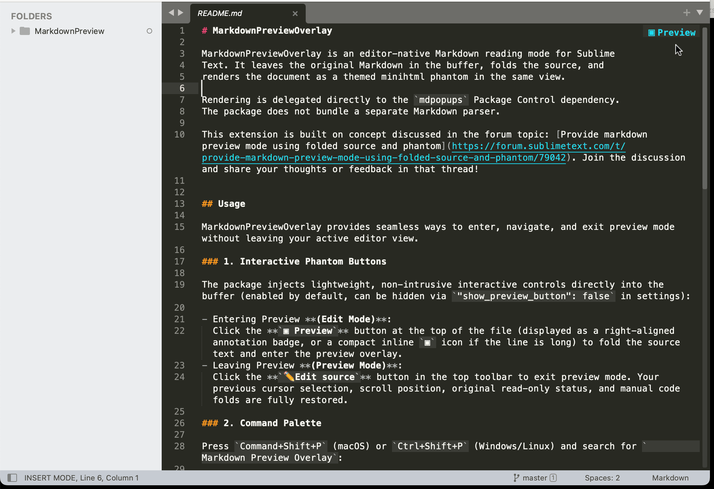

# MarkdownPreviewOverlay

[](https://forum.sublimetext.com/t/provide-markdown-preview-mode-using-folded-source-and-phantom/79042)
[](https://packagecontrol.io/packages/MarkdownPreviewOverlay)

MarkdownPreviewOverlay is an editor-native Markdown preview and reading mode for Sublime Text. It renders formatted Markdown directly inside your active tab—no external browser, no split-pane, and zero context switching.



This overlay concept was originally designed as the chat preview feature for [TermMate](https://packagecontrol.io/packages/TermMate), and extracted into a standalone package as discussed in the forum topic: [Provide markdown preview mode using folded source and phantom](https://forum.sublimetext.com/t/provide-markdown-preview-mode-using-folded-source-and-phantom/79042). Join the forum and share your feedback in that thread!

## Features & Capabilities

Compared to traditional external browsers or split-pane previewers, **MarkdownPreviewOverlay** renders your Markdown preview directly inside the same editor view while keeping your plain-text workflow intact:

- **Zero Context-Switching**: Read and edit in the exact same view—never leave Sublime Text or juggle external browser windows.
- **No Split-Pane Clutter**: Maximizes your entire editor width without dividing the screen into cramped columns or causing premature line wrapping.
- **Position Sync & State Preservation**: Automatically aligns the preview with your current editing position, and seamlessly restores your exact cursors, selections, viewport offset, and Vim (Vintage) mode when toggling.
- **Lightweight**: Powered directly by Sublime Text’s built-in `minihtml` engine (`mdpopups`) with zero background servers, minimal memory overhead, and automatic color scheme alignment.
- **Full Complex Markdown Support**: Seamlessly renders complex Markdown constructs, featuring a custom table engine that auto-adapts to your viewport width, along with syntax-highlighted code blocks, blockquotes, and nested lists tailored for miniHTML.
- **Mermaid Diagrams**: Asynchronously renders fenced `mermaid` blocks into responsive inline diagrams via an auto-detected CLI (`@mermaid-js/mermaid-cli` or `merman-cli`), with graceful code fallback.
- **Math Expressions**: Renders inline `$...$` and display `$$...$$` TeX (including AMS `aligned` and `\underbrace`) to theme-colored images. Requires a local [Node.js](https://nodejs.org/) install of `mathjax` and `@resvg/resvg-js`; without them the formula stays as source.

> **Note**: Rendering is delegated directly to the `mdpopups` Package Control dependency without bundling a separate Markdown parser.

## Installation

The easiest way to install is via [Package Control](https://packagecontrol.io/packages/MarkdownPreviewOverlay):

1. Open the Command Palette: `Command+Shift+P` (macOS) or `Ctrl+Shift+P` (Windows/Linux).
2. Select **`Package Control: Install Package`**.
3. Search for **`MarkdownPreviewOverlay`** and press `Enter`.

## Usage

MarkdownPreviewOverlay provides seamless ways to enter, navigate, and exit preview mode without leaving your active editor view.

### 1. Interactive Phantom Buttons

The package injects lightweight, non-intrusive interactive controls directly into the buffer for saved files (enabled by default, can be hidden via `"show_preview_button": false` in settings):

- **Preview Mode**:
  Click the **`▣ Preview`** button at the top of the file (displayed as a right-aligned annotation badge, or a compact inline `▣` icon if the line is long) to fold the source text and enter the preview overlay.
- **Edit Mode**:
  Click the **`✏️Edit source`** button in the top toolbar to exit preview mode. Your previous cursor selection, scroll position, original read-only status, and manual code folds are fully restored.

### 2. Command Palette

Press `Command+Shift+P` (macOS) or `Ctrl+Shift+P` (Windows/Linux) and search for `Markdown Overlay` (or type `mdo`):

| Command | Description |
| :--- | :--- |
| **`Markdown Overlay: Toggle`** | Toggles seamlessly between Preview Mode and Edit Mode. |
| **`Markdown Overlay: Preview Mode`** | Enters the rendered preview mode for the active Markdown document. |
| **`Markdown Overlay: Edit Mode`** | Exits preview mode and returns to editing the source buffer. |
| **`Markdown Overlay: Refresh`** | Forces a re-render of the preview layout (useful after resizing the window). |

> **Note for Unsaved Buffers**: To keep scratch view clean, the inline `▣ Preview` button is only displayed for saved files on disk. For unsaved or untitled buffers, enter preview mode using the **Command Palette** or a **keyboard shortcut**.

### Behavior & Document Lifecycle

- **Read-only Safety**: Preview mode makes the buffer temporarily read-only to prevent accidental edits while viewing formatted text.
- **Buffer Integrity**: Source folding uses standard Sublime Text region folding without modifying the buffer text or polluting the undo history.
- **Unsaved Buffers & Scratch Pads**: The inline preview button is intentionally omitted on unsaved buffers or scratch pads to prevent visual clutter; use the Command Palette or a keyboard shortcut to preview them anytime.
- **Auto-Refresh**: If the document is modified or saved, the preview updates automatically with debounced re-rendering.
- **Local Images Only**: Only local image files are rendered; remote web images are not downloaded; resolving local relative image paths is enabled by default (disable via `"resolve_image_paths": false`).
- **Keyboard Navigation**: In preview mode, native navigation keys (Up/Down arrows, PageUp/PageDown, Home/End, Cmd+Up/Down) automatically scroll the preview without requiring any custom keybindings.


## Configuration

Access settings and key bindings via the menu: `Preferences -> Package Settings -> MarkdownPreviewOverlay`.

### Settings

Settings can be customized via `Preferences -> Package Settings -> MarkdownPreviewOverlay -> Settings` (or directly in `MarkdownPreviewOverlay.sublime-settings`):

| Setting | Description |
| :--- | :--- |
| **`show_preview_button`** | Display the interactive `▣ Preview` button at the top of saved files in edit mode (default: `true`). |
| **`sync_preview_position`** | Synchronize preview scroll position with the current Markdown source position (default: `true`). |
| **`hide_line_numbers`** | Automatically hide line numbers and the gutter in preview mode (default: `true`). |
| **`show_status_indicator`** | Display the active mode indicator in the status bar during preview mode (default: `true`). |
| **`table_max_width`** | Maximum character width for rendered tables; `null` auto-fits the viewport width (default: `null`). |
| **`resolve_image_paths`** | Rewrite local relative image paths to absolute `file://` URIs for rendering (enabled by default: `true`). Set to `false` if prefer image paths to be untouched. |
| **`image_max_width`** | Maximum display width in pixels for rendered images when `resolve_image_paths` is enabled (default: `900`). |
| **`enable_mermaid`** | Automatically render fenced `mermaid` code blocks as inline images in preview mode (default: `true`). |
| **`mermaid_cli`** | Custom command or path for Mermaid CLI (`mmdc` or `merman-cli`). When empty `""` (default), auto-discovers on common directories. |
| **`enable_math`** | Render `$...$` and `$$...$$` math as images in preview mode (default: `true`). When the Node toolchain is missing, formulas stay as fenced source. |
| **`math_node`** | Node.js executable used to typeset math. When empty `""` (default), auto-discovers `node` on PATH and in common directories. |
| **`math_modules`** | `node_modules` directory (or a folder that contains one) with `mathjax` and `@resvg/resvg-js`. When empty `""` (default), tries `npm root -g` and common install locations. |
| **`keyboard_scroll_lines`** | Number of lines to scroll per arrow key press (Up/Down) in preview mode (default: `3.0`). |

Math rendering shells out to Node and does not download anything during preview. Install the two packages once (Node 18 or newer), globally or in any directory:

```bash
npm install mathjax @resvg/resvg-js
```

A global install is picked up from `npm root -g`. Otherwise set `math_modules` to that `node_modules` directory. Open the preview again after installing. Characters in `\text{}` that the math font does not cover, including Croatian letters such as `š` and `ć`, are drawn with a system font.

### Key Bindings

MarkdownPreviewOverlay does not register a shortcut to avoid collisions. Key bindings are provided as a [keymap example](https://github.com/flashmodel/MarkdownPreviewOverlay/blob/master/Example.sublime-keymap).

To enable keyboard shortcuts, open `Preferences -> Package Settings -> MarkdownPreviewOverlay -> Key Bindings` (or copy from [Example.sublime-keymap](https://github.com/flashmodel/MarkdownPreviewOverlay/blob/master/Example.sublime-keymap) into your User keymap):

```json
[
    {
        "keys": ["primary+alt+r"],
        "command": "markdown_preview_overlay_toggle",
        "context": [{ "key": "setting.is_widget", "operand": false }]
    }
]
```

`primary+alt+r` automatically maps to `Cmd+Option+R` on macOS and `Ctrl+Alt+R` on Windows/Linux in Sublime Text.

## Development installation

Clone or link this directory as `Packages/MarkdownPreviewOverlay`, then run
**Package Control: Satisfy Dependencies**. Package Control installs `mdpopups`
according to `dependencies.json`.

Sublime Text build 4050 or newer is required. The package selects Sublime's
Python 3.8 plugin host through `.python-version`.

## License

This project is licensed under the [Apache-2.0 License](LICENSE).
